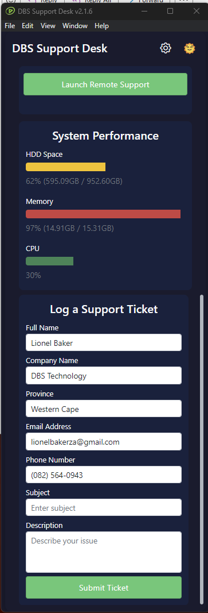
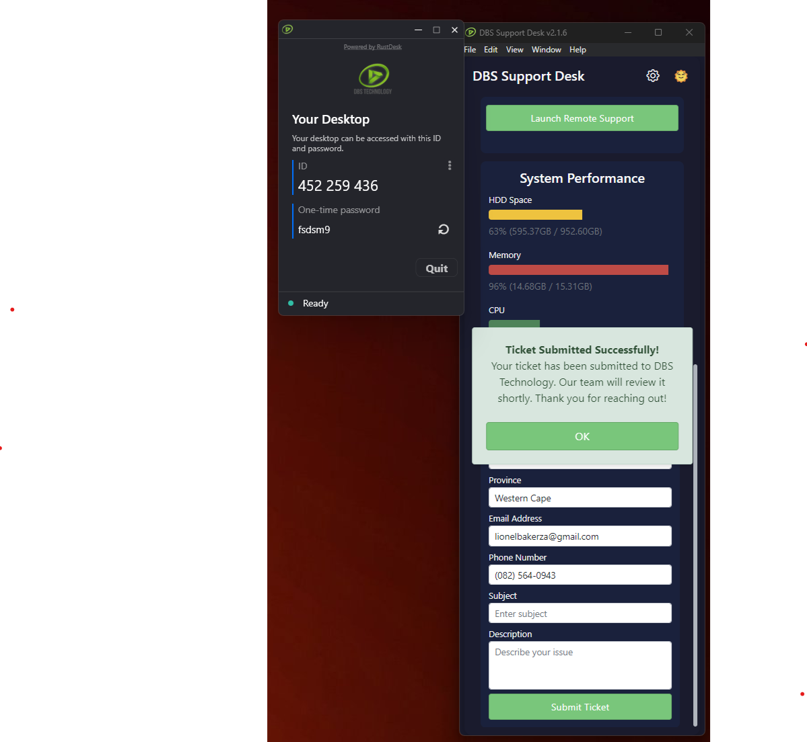
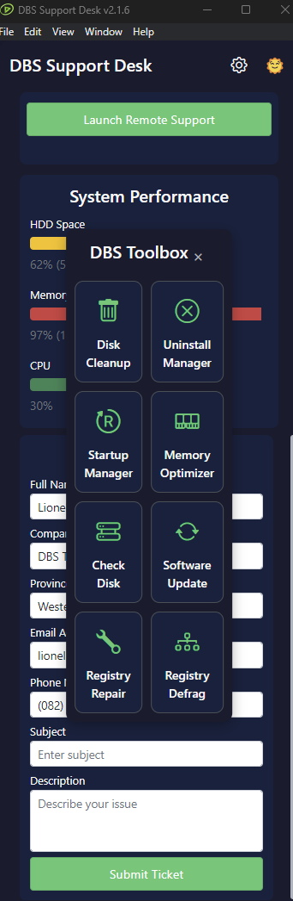
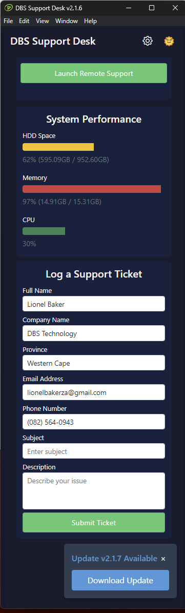

# DBS Support Desk — Technician SOP

**Version:** 2.1.7  
**Last updated:** 2026-10-28

## 1. Purpose
This SOP is for DBS technicians who support customers using the DBS Support Desk app. It covers installation, ticket logging, remote support, the data the app collects, how updates work, and how to guide customers over the phone.

## 2. Supported platforms
- **Windows**: Windows 10/11, x64.
- **macOS**: Intel (x64) and Apple Silicon (arm64).
- Always install the build that matches the customer’s operating system and, for Mac, the correct chip type.

## 3. Installing the app

### Windows
1. Download `DBS-Support-Desk-Setup-<version>.exe` from the GitHub release.
2. Run the installer and follow the prompts.
3. The app installs to the Start menu and runs at startup, showing an icon in the system tray.
4. A portable `DBS-Support-Desk-<version>.exe` is also available for one-off use.

### macOS
1. Download the correct DMG from the GitHub release:
   - `DBS Support Desk-<version>-x64.dmg` for Intel Macs.
   - `DBS Support Desk-<version>-arm64.dmg` for Apple Silicon Macs.
2. Open the DMG and drag `DBS Support Desk` into `Applications`.
3. On first launch, right-click the app and choose **Open** to bypass the unsigned-app Gatekeeper warning.
4. The app runs from `Applications` and may show in the menu bar.

## 4. App overview
- The app is a small support widget for customers.
- It collects contact details and automatically gathers computer information.
- It can launch a remote support session and include the Support ID and password in the ticket email.
- It includes quick system checks through the DBS Toolbox (Windows only).

## 5. How an end user logs a ticket
1. Open **DBS Support Desk** from the Start menu or `Applications`.
2. Fill in the form:
   - **Subject**
   - **Full Name**
   - **Company Name**
   - **Province**
   - **Email**
   - **Phone**
   - **Description** of the issue
3. Click **Submit Ticket**.
4. The app sends a support email to the support desk with the form data and a full system report.

## 6. What the ticket email contains
The email includes:
- **Customer and contact details** from the form.
- **Remote Support Session**: ID and password, when remote support was launched.
- **System information** automatically gathered from the machine:
  - Computer manufacturer, model, serial number, and UUID
  - Operating system version
  - Hostname and username
  - Domain or workgroup membership
  - Microsoft Office products and license details
  - Antivirus product and status
  - System uptime
  - CPU model, core count, and current load
  - Memory total/used
  - Disks, type, size, and usage percentage
  - Network adapters, IP, MAC, and Wi-Fi network
  - Graphics cards
  - Battery status
  - BIOS version and connected displays

None of this is entered by hand; it is pulled directly from the workstation.

## 7. Remote support

### What happens when the user clicks Remote Support
1. The app generates a one-time password in the format `DBS-XXXXX`.
2. It launches the embedded **Remote Assist** client.
3. It waits a few seconds for the client to register, then reads the Support ID.
4. The Support ID and password are added to the ticket email that is sent to the support desk.

### How the technician connects
- Open your Remote Assist client.
- Enter the **Support ID** from the ticket.
- Enter the **Password** from the ticket email.
- **Important:** Use the password in the ticket email, not the one shown inside the customer’s Remote Assist window.

### Phone/screen-share guidance script
- “Click the DBS Support Desk icon in your Start menu or Applications folder.”
- “Fill in your name, company, and a short description of the problem.”
- “Click Remote Support. A small window will open with an ID number.”
- “The password will be in the ticket email. Leave the app open so I can connect.”

## 8. Auto-updater
- The app checks the GitHub release feed on startup.
- Windows clients use `latest.yml`; Mac clients use `latest-mac.yml`.
- When a newer version is available, a dialog prompts the user to download and install it.
- Ask the customer to accept the update to stay on the latest Remote Assist binaries and fixes.

## 9. DBS Toolbox (Windows only)
The DBS Toolbox is opened by clicking the **gear icon** in the top-right corner of the app. It is hidden on macOS because the underlying tools are Windows executables.

The toolbox launches small built-in utilities from the `tools/dbs-utilities` folder. Each tool opens in its own window. Do not ask the customer to run these unless you are actively troubleshooting the machine.

- **Disk Cleanup** — removes temporary and unnecessary files to free up disk space.
- **Uninstall Manager** — shows installed programs and lets the customer remove unwanted software.
- **Startup Manager** — lists programs that start with Windows and lets you enable or disable them.
- **Memory Optimizer** — attempts to free up system RAM.
- **Check Disk** — launches a disk health and error check.
- **Software Update** — scans for available software updates.
- **Registry Repair** — scans the Windows registry for errors and offers to fix them.
- **Registry Defrag** — compacts the Windows registry.

All of these tools may require administrator rights. If a tool fails to open, ask the customer to close the app, right-click the DBS Support Desk shortcut, and choose **Run as administrator**.

### Built-in quick checks
The main app window also shows live summary metrics without opening the toolbox:
- Disk usage progress bar
- Memory usage progress bar
- A full system summary that is included with every support ticket.

## 10. Troubleshooting basics
- **Mac app won’t open the first time:** Right-click the app, choose **Open**, and confirm.
- **No Support ID appears:** Wait 10 seconds and click Remote Support again. The client may need more time to register.
- **Invalid password:** Confirm you are using the password from the ticket email, not the on-screen one-time password.
- **No update prompt:** Close and reopen the app; it only checks on startup.
- **Installer blocked by antivirus:** Whitelist `DBS Support Desk` or use the portable `.exe`.

## 11. Where to get the latest builds
- GitHub releases: https://github.com/dbsdeskza/dbs-support-desk/releases
- Always choose the installer or DMG that matches the customer’s operating system and Mac architecture.

## 12. Visual guide
To make this SOP easier to follow, add the following screenshots to `assets/sop/` and the document will display them automatically:

- **Main app window:**
  
- **Ticket form filled in:**
  
- **Remote Support launched:**
  
- **DBS Toolbox open:**
  
- **Update prompt:**
  

If you provide the screenshot files, I will embed them here.
